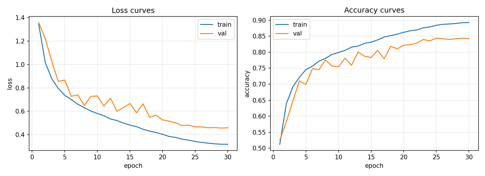
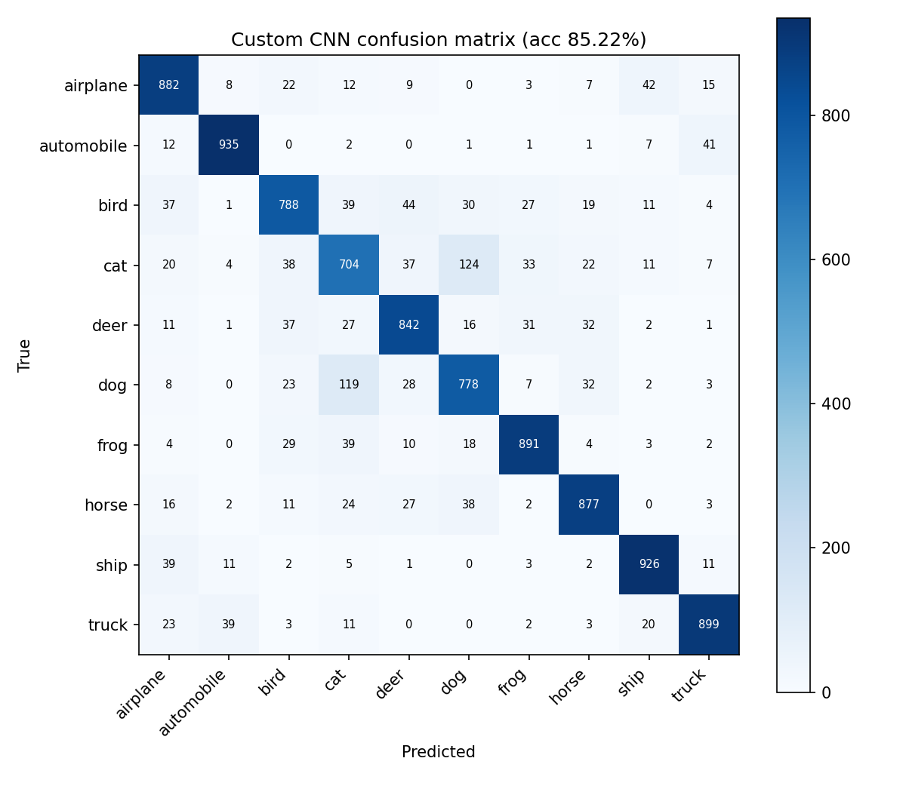

# Technical Notes — Slot B: Custom CNN (Duke)

## 1. Objective and experiment setup

Train a custom convolutional neural network (CNN) **from scratch** to classify the ten CIFAR-10 image categories (airplane, automobile, bird, cat, deer, dog, frog, horse, ship, truck). Compare the model's performance and limitations with the project's hand-engineered Histogram of Oriented Gradients (HOG) + linear SVM baseline.

- **Framework:** PyTorch; no pretrained weights.
- **Dataset:** CIFAR-10, 32 × 32 RGB images.
- **CNN data split:** 45,000 training, 5,000 validation, and 10,000 test images. The shared splitting helper selects 500 validation images per class using seed 0; the remaining 4,500 per class are training examples.
- **Hardware:** CUDA GPU (Google Colab T4 runtime).
- **Model selection:** Best validation **accuracy**, followed by a single held-out test-set evaluation. Test-set accuracy was not used to select the checkpoint.
- **Implementation:** `custom_cnn.py` (architecture, training/evaluation helpers) and `train_custom_cnn.py` (data transforms, experiment, and saved artifacts).

## 2. CNN architecture

The experiment uses the repository's **original, unchanged four-block starter architecture**. This is a small, custom-defined CNN rather than a pretrained network. No extra blocks or dropout were added in this run; therefore, the reported results should not be presented as evidence of an architectural modification.

| Stage | Layers and settings | Output for one 32×32 RGB input |
| --- | --- | --- |
| Input | RGB image | `3 × 32 × 32` |
| Block 1 | `Conv2d(3, 32, 3×3, padding=1, bias=False)` → `BatchNorm2d(32)` → `ReLU` → `MaxPool2d(2)` | `32 × 16 × 16` |
| Block 2 | `Conv2d(32, 64, 3×3, padding=1, bias=False)` → `BatchNorm2d(64)` → `ReLU` → `MaxPool2d(2)` | `64 × 8 × 8` |
| Block 3 | `Conv2d(64, 128, 3×3, padding=1, bias=False)` → `BatchNorm2d(128)` → `ReLU` → `MaxPool2d(2)` | `128 × 4 × 4` |
| Block 4 | `Conv2d(128, 256, 3×3, padding=1, bias=False)` → `BatchNorm2d(256)` → `ReLU` → `AdaptiveAvgPool2d(1)` | `256 × 1 × 1` |
| Head | Flatten → `Linear(256, 10)` | `10` class logits |

**Trainable parameters: 391,466 (approximately 0.39 million).** The number of channels increases (32 → 64 → 128 → 256) as the spatial resolution decreases, allowing the model to learn increasingly complex visual features. All convolutions use 3×3 kernels with padding 1 to preserve spatial resolution inside each convolutional layer.

**What the layers do:** A convolution learns spatial filters (e.g., edges, textures, and increasingly complex patterns). Batch normalization stabilizes feature distributions during optimization. ReLU introduces nonlinearity, allowing the network to learn more than a linear mapping. Max pooling halves width and height while reducing computation. Adaptive global average pooling compresses each of 256 final feature maps to one value; the linear head maps those features to 10 scores (**logits**) used by cross-entropy loss. The model does not need an explicit softmax layer during training because `CrossEntropyLoss` handles the appropriate logits-to-probabilities computation internally.

## 3. Training setup and hyperparameters

| Setting | Value |
| --- | --- |
| Initial weights | Randomly initialized; trained from scratch |
| Epochs | 30 |
| Training batch size | 128 |
| Validation / test batch size | 512 |
| Optimizer | Adam |
| Initial learning rate | `0.001` |
| Weight decay | `0.0005` (`5e-4`) |
| Learning-rate schedule | Cosine annealing (`T_max = 30`) |
| Loss | Cross-entropy |
| Random seed | 0 (NumPy and PyTorch seeds set) |
| Training augmentation | Random 32×32 crop with padding 4; random horizontal flip |
| Preprocessing for all splits | Convert image to tensor; normalize with CIFAR-10 RGB mean `(0.4914, 0.4822, 0.4465)` and std `(0.2023, 0.1994, 0.2010)` |
| Validation/test augmentation | None; only tensor conversion and normalization |
| Device | `cuda` |

For each training batch, the loop sends images and labels to the device, clears gradients, computes predictions and cross-entropy loss, calls `loss.backward()` to compute gradients, and calls `optimizer.step()` to update weights. At each epoch's end, evaluation runs with `model.eval()` and `torch.no_grad()` so that BatchNorm uses its evaluation behavior and no gradients are tracked. The cosine scheduler then updates the learning rate. The model's weights are copied whenever validation accuracy improves; the **best-validation** weights are restored before saving `model.pt` and testing.

## 4. Experimental results

The following values come from this run's saved `results/metrics.json`, `results/confusion_matrix.npy`, and training output; they are **measured results**, not estimates.

| Metric | Custom CNN result |
| --- | ---: |
| Held-out test top-1 accuracy | **85.22%** |
| Held-out test macro F1 score | **0.8519** |
| Correct test predictions | **8,522 / 10,000** |
| Best validation accuracy | **84.38%** (epoch 29) |
| Final-epoch training accuracy | 89.26% |
| Final-epoch validation accuracy | 84.22% |
| Final-epoch training loss | 0.3185 |
| Final-epoch validation loss | 0.4594 |
| Total training time | 9.6 minutes |
| Forward-pass time per image | 0.29 ms/image, **CUDA GPU** (as measured by the provided script) |
| Trainable model parameters | 391,466 (~0.39M) |

The test accuracy exceeded the template's approximate 65–75% expectation. The final-epoch training-versus-validation accuracy gap was **5.04 percentage points** (89.26% − 84.22%). Note that the last-epoch values refer to the training-history curves, while the saved model and final test metrics use the **best-validation checkpoint**.

### 4.1 Training curves



**Interpretation:** Training loss steadily decreased, while validation loss also declined overall but fluctuated and flattened near the end. Training accuracy reached approximately 89%, with validation accuracy near 84%. The persistent training–validation gap indicates **some overfitting**, although the validation trend remained good and the final gap was relatively modest. Random cropping, horizontal flipping, weight decay, and selecting the best validation checkpoint helped address generalization. They do **not** prove that overfitting was completely eliminated.

### 4.2 Confusion matrix and class-level findings



Rows show **true** labels; columns show **predicted** labels. The diagonal represents correctly classified images. Each class has 1,000 test examples. The largest paired error is **cat ↔ dog**: 124 cats were predicted as dogs, and 119 dogs were predicted as cats.

| CIFAR-10 class | CNN F1 |
| --- | ---: |
| Airplane | 0.8596 |
| Automobile | **0.9345** |
| Bird | 0.8070 |
| Cat | **0.7104** |
| Deer | 0.8428 |
| Dog | 0.7761 |
| Frog | 0.8910 |
| Horse | 0.8774 |
| Ship | 0.9150 |
| Truck | 0.9053 |

The highest class F1 is for automobiles (0.9345), while cats (0.7104) and dogs (0.7761) remain difficult. This is consistent with visually similar animal categories being harder to distinguish in small 32×32 images.

## 5. Comparison with HOG + linear SVM (Slot A)

The repository's existing HOG baseline reports the following values (`ron-hog-svm/results/metrics.json`).

| Metric | HOG + linear SVM | Custom CNN |
| --- | ---: | ---: |
| Test accuracy | 52.06% | **85.22%** |
| Macro F1 | 0.5116 | **0.8519** |
| Recorded training time | 0.8 min | 9.6 min |
| Recorded inference time | 0.13 ms/image **CPU** | 0.29 ms/image **GPU** |
| Number of training images | 50,000 | 45,000 |
| Learned representation | Handcrafted HOG gradient features | CNN filters learned from images |
| Recorded parameter count (project reporting convention) | 0M classical-model entry | 0.39M |

**Where the CNN wins:** The CNN's accuracy is **33.16 percentage points** higher, with macro F1 improving by 0.3403. HOG describes local edge orientations using fixed, handcrafted features and a linear classifier, whereas the CNN jointly learns filters and a nonlinear decision function. On this test set the CNN's gains are especially clear for difficult animal classes: cat F1 increased from 0.3047 (HOG) to 0.7104 (CNN), and dog F1 from 0.3794 to 0.7761. Unlike the HOG pipeline, the CNN also makes direct use of RGB color information. These outcomes suggest learned representations were more effective for the visual variation present in CIFAR-10.

**Where HOG wins / CNN costs:** HOG + SVM is simpler to train, requires far less reported training time, and runs with CPU-only inference in the recorded benchmark. The CNN requires a GPU for efficient training, many more learnable weights, and more compute; it is also still imperfect at fine-grained animal distinctions. HOG's explicit gradient representation and linear decision rule are easier to inspect. Neither model was tested here for calibration, robustness to domain shift, or energy consumption, so no such advantage is claimed.

**Fairness and timing caveats:** The saved HOG run trained on **all 50,000** official CIFAR-10 training images, whereas this CNN used **45,000 for training and 5,000 for validation**. Both evaluated the official 10,000-image test set, but this is not a fully matched train/validation protocol. HOG and CNN inference times were measured on **different hardware (CPU versus GPU)** and with **different timing boundaries**: the CNN's script times forward passes, while HOG includes feature extraction and prediction. Direct inference-speed rankings are therefore not justified by these numbers. The recorded training-time figures are also not identical end-to-end accounting methods. A strictly controlled comparison should use matching training splits, the same hardware, the same timing boundaries, and multiple random seeds.

The HOG metrics file also reports **17,650 learned SVM weights and biases**; the `0M` value above follows the project's classical-method reporting convention and does not mean the SVM has no learned coefficients.

## 6. Reproducibility, limitations, and artifacts

Run the project script in a Colab GPU runtime from the repository checkout, after ensuring that the CIFAR-10 Python batches are placed where `shared/data_utils.py` expects them:

```bash
cd duke-custom-cnn
python -u train_custom_cnn.py
```

The data loader expects `data/cifar-10-batches-py/` at the repository data location (relative to the shared helper). During this Colab session, a directory-path correction was required before training could start; it did **not** change the CNN architecture or the evaluation protocol. The saved checkpoint is a PyTorch `state_dict`, not a complete serialized model object.

**Saved experiment evidence** (under `duke-custom-cnn/results/`):

- `metrics.json` — numerical metrics and hyperparameters.
- `training_curves.png` — 30-epoch train/validation loss and accuracy.
- `confusion_matrix.png` and `confusion_matrix.npy` — confusion matrix visualization and raw counts.
- `model.pt` — model weights selected by validation accuracy.
- `training_log.txt` — summary log of run and evaluation.

The supplied training script's saved `training_log.txt` is a **summary**, not a complete per-epoch transcript: detailed epoch output appeared in the Colab cell and is represented visually by `training_curves.png`. Only one training run is documented here. Results may vary across seeds or environments, and no architecture ablation or additional hyperparameter search was performed.

## 7. Source files consulted

- CNN implementation: [`duke-custom-cnn/custom_cnn.py`](https://github.com/JethroIsHere/prism/blob/main/duke-custom-cnn/custom_cnn.py)
- Training script: [`duke-custom-cnn/train_custom_cnn.py`](https://github.com/JethroIsHere/prism/blob/main/duke-custom-cnn/train_custom_cnn.py)
- Shared training guidance: [`shared/cnn_resnet_recipes.md`](https://github.com/JethroIsHere/prism/blob/main/shared/cnn_resnet_recipes.md)
- HOG baseline metrics: [`ron-hog-svm/results/metrics.json`](https://github.com/JethroIsHere/prism/blob/main/ron-hog-svm/results/metrics.json)
- CNN measurements: the saved run artifacts listed in Section 6.
